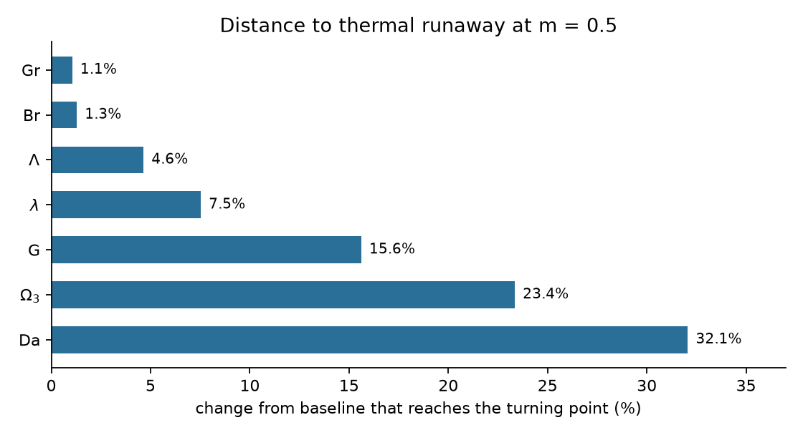

# Third-grade fluid microchannel flow: BVP solver and neural network surrogate

Master's research project. It models electroosmotic flow of a reactive third-grade
fluid in a vertical porous microchannel with velocity and thermal slip, and trains a small neural network to
predict two wall quantities:

- wall shear stress `Sxy = u' + 2 Λ u'³` at `y = 1`
- wall Nusselt number `Nu = -θ'` at `y = 1`

The network is trained by the conjugate gradient (CG) method and compared with Adam in three batch regimes.

## Model

```
u'' + 6Λ(u')²u'' + G − u/Da + Gr θ + K²Ω₃ φ = 0
θ'' + Br(u')² + 2ΛBr(u')⁴ + Sₙ + λ(1+Ωθ)^m exp(−E₁/(1+Ωθ)) = 0
φ = cosh(Ky)/cosh(K),   −1 ≤ y ≤ 1
```

`m` is the reaction order: −2 sensitised, 0 Arrhenius, 0.5 bimolecular.
Baseline: Br 0.5, λ 1, G 2, Gr 3.5, Da 2, Λ 0.5, Ω₃ 1, K 2, Sₙ 1, Ω 1, E₁ 2, γ₁ = λ₁ = 0.01.

## Folders

| Folder | Content |
|---|---|
| `original/` | code, data and figures of the first study, **unchanged** (tag `v1.0-original`) |
| `src/` | corrected code |
| `data/` | datasets at full precision |
| `results/`, `figures/` | output of the corrected code |

[CHANGES.md](CHANGES.md) lists what was corrected and why.

## Run

```
pip install -r requirements.txt
python src/verify_solver.py         # residuals and Newtonian limit
python src/tgf_full_analysis.py     # baseline profiles and sweeps
python src/parametric_plots.py      # parametric figures
python src/critical_points.py       # thermal runaway limits
python src/make_datasets.py         # OFAT and Latin hypercube data
python src/train_surrogate.py       # CG surrogate, 10 seeds
python src/compare_optimizers.py    # CG against Adam, 10 seeds (several minutes)
```

`src/diagnostics/` holds extra checks. Results were produced with the versions in `requirements.txt` on Python 3.12.
CG stops at its iteration limit before full convergence, so the last digits can change with the SciPy version.

## Results

### Solver
Residuals of both equations are below 5e-8, and the Newtonian limit matches the exact solution to 1.8e-12.

| m | u max | θ max | Sxy | Nu |
|---|---|---|---|---|
| −2 | 2.1520 | 3.1009 | −8.6647 | 4.6829 |
| 0 | 2.3084 | 4.0605 | −10.4453 | 6.6270 |
| 0.5 | 2.7203 | 7.1258 | −16.3635 | 13.0135 |

### Thermal runaway
At m = 0.5 the baseline is very close to runaway, first in Gr and Br.



Runaway also exists at m = 0 (Br 0.565) and m = −2 (Br 0.599). All values: `results/critical_points.csv`.

### Surrogate (CG, 10 hidden neurons, median of 10 seeds)

| Trained on | Target | R², own held-out split | R², 400 independent points | R², sweeps near runaway |
|---|---|---|---|---|
| OFAT sweeps | Nu | 0.992 | −4857 | |
| OFAT sweeps | Sxy | 0.989 | −344 | |
| Latin hypercube | Nu | 0.990 | **0.996** | 0.62 |
| Latin hypercube | Sxy | 0.997 | **0.998** | 0.56 |
| Both | Nu | 0.991 | 0.836 | |
| Both | Sxy | 0.994 | 0.985 | |

- A network trained only on one-factor-at-a-time (OFAT) sweeps must not be used away from those lines, even though
  its held-out R² is high. Neighbouring sweep points end up in both training and test sets.
- The Latin hypercube network is accurate inside the box but not close to runaway. Use the solver there.

### Optimizers (mean test RMSE of 10 seeds, same initial weights and split)

| Method | OFAT Nu | OFAT Sxy | LHS Nu | LHS Sxy |
|---|---|---|---|---|
| CG | **0.249** | 0.295 | 0.055 | 0.099 |
| Adam, batch, tuned, 5500 epochs | 0.350 | 0.342 | 0.070 | 0.102 |
| Adam, mini-batch, tuned | 0.305 | 0.318 | 0.056 | 0.093 |
| Adam, SGD, lr 1e-3 | 0.300 | **0.287** | **0.045** | **0.081** |
| Adam, batch, lr 1e-3, 1500 epochs (first study) | 1.239 | 1.343 | 0.271 | 0.605 |
| Adam, mini-batch, lr 1e-3 (first study) | 0.492 | 0.504 | 0.083 | 0.143 |

CG is the most accurate only for Nu on the OFAT data. On the Latin hypercube data SGD is slightly better (7 of 10
seeds for Nu, 8 of 10 for Sxy) and tuned mini-batch is about equal. CG always beats full-batch Adam on average, and it
has no learning rate to tune. Learning rates were tuned on a small grid only (2 or 3 values, chosen on validation
error), SGD was not tuned, and Levenberg-Marquardt was not tested.

## Limits of this work

- The baseline was revised in July 2026 (Gr 3 to 3.5, Sₙ 2 to 1, Ω 0.5 to 1) to make the effect of m easier to see.
  The size of that effect depends on the baseline: from m = −2 to 0.5, Nu rises by 178 % here and by 34 % at the earlier one.
- K = 2 gives a thick double layer (φ = 0.27 at the centre), so a thin-layer reading does not apply.
- With Ω = 1 the temperature range is wide for the Boussinesq approximation.
- No comparison with experiments.
